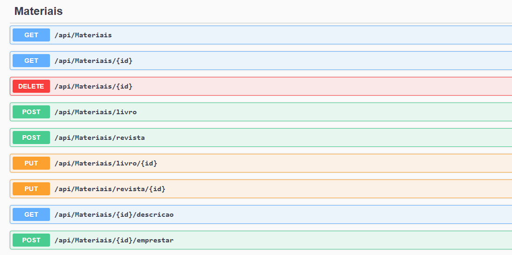

# O que foi desenvolvido:
Inicialmente desenvolvemos um sistema para gerenciamento de uma biblioteca, onde nela seria possivel exibir, alterar e cadastrar materiais, como por exemplo, livros e revistas. Buscamos trazer uma interface simples que não demandasse muitas técnicas para que pudessemos entregar o sistema a tempo, por isso focams em algo simples e minimalista.

## Como executar a API:
1 . Clone o Repositório( Via CMD ):
`git clone URL`

2 . Rodar o projeto( Via CMD ):
`dotnet run`

3 . Acrescentar a URL da API:
`Padrão gerado inicialmente: http://localhost:5228`
`Acrescentar a URL: http://localhost:5228/swagger/index.html`

## Como abrir ou executar o front-end:
1 . Rodar o projeto( Via CMD ):
`dotnet run`

2 . Acessar a URL do projeto:
`http://localhost:5228/index.html`

## URL da API utilizada:
`const API_URL = "http://localhost:5228/api/Materiais";`

## Endpoints consumidos:
#### - Todos os endpoints foram consumidos!


## Como o front-end foi organizado:
Como dito anteriormente focamos em uma página simples e minimalista, então fizemos uma Landing Page com todas as funcionalidades. Inicialmente começamos com a construção do "header", o cabeçalho do nosso sistema web, nele temos a logo, o nome do projeto e no canto direito temos um pequeno campo de busca de material por ID. Logo mais seguimos para de fato o corpo do sistema onde organizamos atavés de classes que carregam uma sequência. Inicialmente temos a "main" mais conhecido como a classe mão onde armazena todo o conteúdo da página, logo mais temos nossa primeira "section" as seções nós separamos por conteúdo, nesse caso a de Dashboard, onde exibe todos materiais como um todo e também livros e resvistas de forma individual. Seguindo logo mais temos nossa "section" de cadastro onde é possivel que o usuário realize o cadastro de um material, seja ele livro ou revista. E por fim temos nossa "section" de listagem de materiais, sejam revistas ou livros, nela é possivel que o usuário faça algumas coisas como por exemplo: Consultar, Ver descrição, Emprestar, Editar e Excluir.

### - Estrutura principal:
```html
├── head
│   └── links (Bootstrap, Font Awesome, CSS)
│
└── body
    ├── header
    │   └── nav
    │       ├── logo / nome
    │       └── formulário de busca
    │
    ├── main
    │   ├── section — Dashboard
    │   │   ├── Materiais
    │   │   ├── Livros
    │   │   └── Revistas
    │   │
    │   ├── section — Cadastro
    │   │   ├── Formulário de Livro
    │   │   └── Formulário de Revista
    │   │
    │   └── section — Lista de materiais
    │       └── Cards dos materiais
    │
    ├── template
    │   └── Modelo do card de material
    │
    ├── div
    │   └── Toasts / mensagens
    │
    ├── div
    │   ├── Modal — Detalhes
    │   ├── Modal — Descrição
    │   └── Modal — Edição
    │
    └── scripts
        ├── Bootstrap
        └── script.js
```

## Componentes do Bootstrap utilizados:
- NavBar;
- Cards;
- Forms;
- Buttons;
- Alerts;
- Modals;
- Toast;
- Espaçamento;
- Estilização de texto;
- Responsividade.

## Validações implementadas:
- Se alguém souber, completar fazendo favor!

## Dificuldades encontradas;
- Inicialmente nossa principal dificuldade foi tentar entender como fariamos a ligação de uma API em C# com o front feito em HTML e CSS, até o momente nunca tinhamos tido o contato com esse tipo de implementação, então foi algo novo que tivemos que buscar a entender e realizar o projeto. Outra dificuldade que encontramos no inicio foi a questão de organização no Git, tivemos muitos conlitos por pouco conhecimento e uso da ferramenta, porém acabamos nos acostumando com a ferramenta em questão.

## Como as dificuldades foram resolvidas:
Bom, nós buscamos entender como fariamos a ligação da API com o front de diversas maneiras, através de sites, publicações de exemplos, e também através de recursos de IA que buscamos usa-lo para entender melhor o funcionamento de um projeto web voltado para essa linguagem(C#). A questão do Git tivemos auxilio dos professores em sala de aula, de como usarmos a ferramenta, nos dando dicas de como prosseguir com ela.

## O que cada integrante aprendeu:
1 . Angelo: Aprendi a me comunicar com a equipe e para que serve o GET, PUT, POST e DELETE alem de ajudar a aplica-los no JS ;<br>

2 . Daniel: Aprimorei meus conhecimentos em estruturação de html e css, juntamente da utilização do Bootstrap. Além disso entendi de maneira correta o funcionamento do Git;<br>

3 . Gabriel: Compreendi a utilização do JavaScript para a integração de uma API no front-end;<br>

4 . Pedro: Aprendi a utilizar JavaScript para consumir APIs, realizar requisições HTTP e manipular os dados, integrando as funcionalidades do back-end à interface do usuário. <br>

## Integrantes e RGM:
1 . Angelo Apontes Cabral 114.092

2 . Daniel Próspero de Figueiredo 114.070

3 . Gabriel Augusto Paulino Rodrigues 114.062

4 . Pedro Pereira de Souza 114.047
